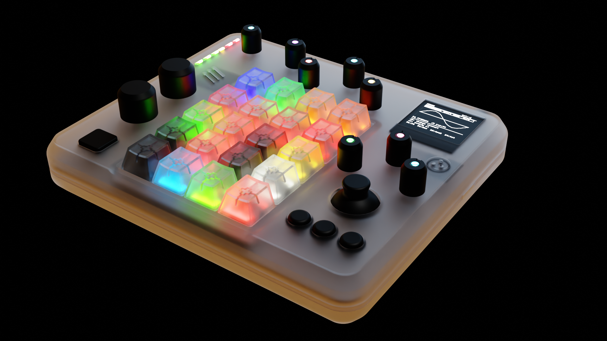
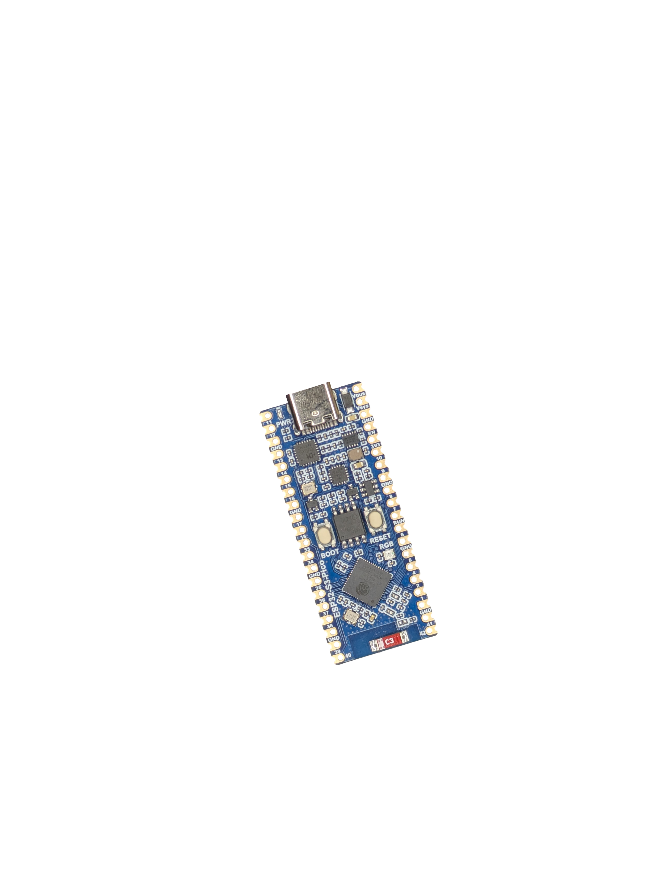

# SevenSynthCore

*Custom hardware · Custom DSP engine*

A from-scratch polyphonic synthesizer and sampler on a single microcontroller: its own audio engine, a modular signal
graph, a 128×128 OLED UI, and a surprisingly large palette of weird sounds.

The instrument is the **Ritual Machine**. **SevenSynthCore** is the library under it (engine, drivers, drawing kit),
which other synths can be built on.



**Status: beta 1.1** (pre-release). The firmware for the first prototype and a Windows simulator are on the
[releases page](https://github.com/sevenist/SevenistSynth_RitualMachine/releases). No hardware needed to try it:
unzip the simulator and play it from the PC keyboard.

---

## The instrument

Two sections, one switch away from each other: a synth and a sampler.

| | |
| --- | --- |
| **Modular rack** | Up to 16 modules chained freely in two parallel branches and a shared master row. Mono, paraphonic or polyphonic, up to 8 voices. |
| **Six-op FM** | DX7-style engine: 32 algorithms, 128 patches, every operator editable on the machine. Because why not. |
| **Strings** | Up to 32 voices. Detuned oscillator pairs, key-tracked low-pass, three-tap ensemble chorus on the bus. |
| **Pads** | 64 sample pads in 4 banks, 8 voices, streamed from the TF card. Loops with crossfade, choke groups, starts on the beat, three FX chains. |

- **Oscillators**: 6 classic waves, 9 engines written for it (Karplus string, modal, FM, wavefolder, supersaw, vowel,
  additive, dust, string machine) and 47 models from Mutable Instruments' Braids and Plaits.
- **Filters and shaping**: 9 filter types (12 / 24 dB, ladder, notch, all-pass ...), 10 saturation modes, a comb resonator.
- **Modulation, at audio rate**: LFOs, envelopes with curves, a multi-stage envelope, a 4-lane motion sequencer, velocity.
- **Effects**: delay, plate reverb, chorus, ensemble, phaser, flanger, tremolo, EQ, compressor, ring modulator,
  FFT spectral effects (freeze, gate, pitch, robot, whisper), cabinet convolver.
- **Sequencers**: 64 steps with chords, velocity, probability and ratchets for the synth; a step sequencer over all
  64 pads; 8 patterns and a chain for each; step and live recording.
- **Sample tools on the machine**: chop to pads, then trim, normalize, reverse, time-stretch, pitch, Paulstretch and
  lo-fi, with a version history to undo. **Capture** records whatever plays onto a pad: resample, mangle, repeat.
- **Hands on**: 8 macros, the joystick as an XY controller, Shift and Mod layers for every control, editable key
  layouts, presets, and a sound that comes back as you left it.

<!--  -->
<!--  -->

---

## Under the hood

The engine, the UI and the hardware layer were written for this machine.
The audio path never allocates, never locks, never logs: no compromise on determinism.

- **One code base, two targets.** The same engine and UI run on the ESP32-S3 and in a desktop window. What you hear
  is what you get.
- **A library and its apps.** `framework/` is the library: the DSP engine, the board drivers behind one interface, and
  a small drawing kit. `apps/` holds the Ritual Machine and a starter template.
- **Boards are data.** Each board lists its controls in a table; the simulator draws its front panel from that table,
  so an app can be tried as any board before the hardware exists.
- **RGB key feedback.** One LED per key: note colours, held notes, pads, play and mode states. The colours are editable.

---

## Hardware

Original hardware, designed and built from scratch.

| | |
| --- | --- |
| MCU | ESP32-S3, dual core, 240 MHz |
| Audio DAC | PCM5102APWR |
| Amplifier | LM4871, built-in speaker |
| Keys | 36: 4 function keys + 4 rows of 8, one RGB LED each |
| Controls | 7 endless knobs through a CD4067 16-channel analog mux, joystick with push |
| Display | 128×128 OLED |
| Storage | TF card, also a USB drive on the computer |
| Power | 2S/3S Li-ion battery · IP2326 charger |
| Open hardware | Schematics + 3D files, coming soon |



<!--  -->
<!--  -->

> **Hardware v2 in progress** - better performance, better controls, details coming.

---

## Build & run

On Windows, with [MSYS2](https://www.msys2.org/) UCRT64 (gcc, g++, SDL2) and Python 3. The firmware builds with
[PlatformIO](https://platformio.org/).

```powershell
git clone https://github.com/olikraus/u8g2 lib/u8g2     # the display library, once
.\build.ps1                    # the simulator
.\run.ps1                      # two windows: the screen and the front panel
.\build.ps1 -Board hwv1        # the same, drawn as the first prototype
.\test.ps1                     # the host tests
pio run -d apps/ritual_machine -t upload                # flash the first prototype
```

**Your own synth on the library:**

```powershell
.\tools\new_project.ps1 my_synth       # apps/my_synth, from the template
.\build.ps1 -App my_synth
.\run.ps1 -App my_synth
```

Where to read next:

- [apps/template/README.md](apps/template/README.md): the starter app, file by file.
- [CHANGELOG.md](CHANGELOG.md): what each release changed, and a tour of the library.
- [docs/guides/](docs/guides/README.md): the drawing kit, the Ritual Machine's screens, the serial commands.

---

## Roadmap

- [x] Custom modular rack engine
- [x] FM (six-op) + Strings synth types with dx7 presets
- [x] RGB key LEDs + OLED UI
- [x] Sampler engine - TF-card playback
- [x] Resampling workflow - record, mangle, and re-pitch any sound the synth makes
- [x] Step sequencers for the synth and the pads
- [x] The engine as a library, with a template for new synths
- [ ] Hardware v2 - v1 schematics and 3D files releasing alongside it

---

## Credits

The Braids and Plaits oscillator models are the work of Émilie Gillet (Mutable Instruments), MIT licence.
Everything this project builds on is listed in [THIRD_PARTY_NOTICES.md](THIRD_PARTY_NOTICES.md).

*SevenSynthCore · by sevenist*
