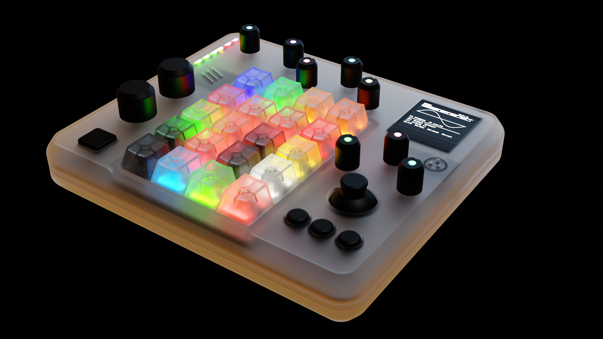
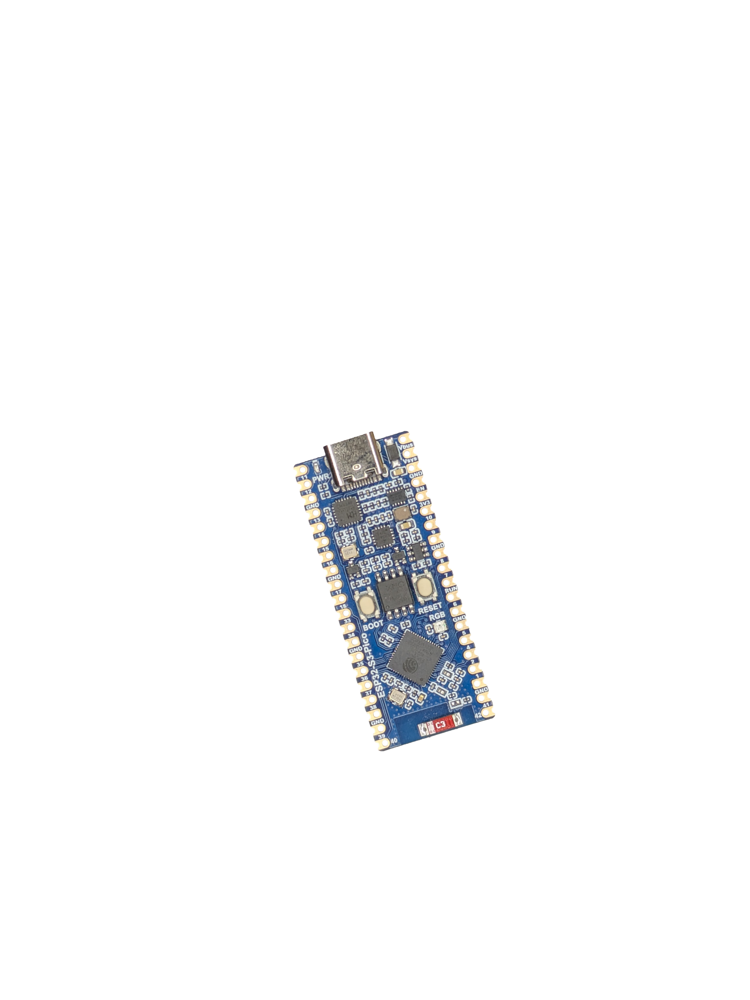

# SevenSynthCore

*Custom hardware · Custom DSP engine*

A from-scratch polyphonic synthesizer and sampler on a single microcontroller: its own audio engine, a modular signal
graph, a 128×128 OLED UI, and a surprisingly large palette of weird sounds.

The instrument is the **Ritual Machine**. **SevenSynthCore** is the library under it (engine, drivers, drawing kit),
which other synths can be built on.



**Status: beta 1.1** (pre-release). The firmware for the first prototype and a Windows simulator are on the
[releases page](https://github.com/sevenist/SevenistSynth_RitualMachine/releases). No hardware needed to try it:
unzip the simulator and play it from the PC keyboard.

---

## The apps

| App | What | Status |
| --- | --- | --- |
| [**The Ritual Machine**](apps/ritual_machine/README.md) | the instrument: a modular rack, six-op FM and Strings synth beside 64 streamed sample pads, sequencers, sample tools on the machine | beta 1.1 |
| [**TechnoGen**](apps/technogen/README.md) | a techno loop generator for the second prototype: seven tracks and a dice, in colour | first version, simulator |
| [**SynthLab**](apps/synthlab/README.md) | a workbench for home-made synths: small all-in-one synths, one file each, a list of values and two encoders | new, simulator |
| [**SynthLab Studio**](apps/studio/README.md) | SynthLab's synths on the desktop with the mouse: every value as a knob, macros dragged onto knobs, the board's screen arranged by hand | new, desktop only |
| [**template**](apps/template/README.md) | the starter app: a four-voice synth with a screen and the board's keys | |

The library under them is [framework/](framework/README.md): the DSP engine, the boards behind one interface, the drawing kit.

---

## Under the hood

The engine, the UI and the hardware layer were written for this machine.
The audio path never allocates, never locks, never logs: no compromise on determinism.

- **One code base, two targets.** The same engine and UI run on the ESP32-S3 and in a desktop window. What you hear
  is what you get.
- **A library and its apps.** `framework/` is the library: the DSP engine, the board drivers behind one interface, and
  a small drawing kit. `apps/` holds the Ritual Machine, TechnoGen, SynthLab, SynthLab Studio and a starter template.
- **Boards are data.** Each board lists its controls in a table; the simulator draws its front panel from that table,
  so an app can be tried as any board before the hardware exists.
- **RGB key feedback.** One LED per key: note colours, held notes, pads, play and mode states. The colours are editable.

---

## Hardware

Original hardware, designed and built from scratch.

| | |
| --- | --- |
| MCU | ESP32-S3, dual core, 240 MHz |
| Audio DAC | PCM5102APWR |
| Amplifier | LM4871, built-in speaker |
| Keys | 36: 4 function keys + 4 rows of 8, one RGB LED each |
| Controls | 7 endless knobs through a CD4067 16-channel analog mux, joystick with push |
| Display | 128×128 OLED |
| Storage | TF card, also a USB drive on the computer |
| Power | 2S/3S Li-ion battery · IP2326 charger |
| Open hardware | Schematics + 3D files, coming soon |



<!--  -->
<!--  -->

> **Hardware v2 in progress** - better performance, better controls, details coming.

---

## Build & run

On Windows, with [MSYS2](https://www.msys2.org/) UCRT64 (gcc, g++, SDL2) and Python 3. The firmware builds with
[PlatformIO](https://platformio.org/).

```powershell
git clone https://github.com/olikraus/u8g2 lib/u8g2     # the display library, once
.\build.ps1                    # the simulator
.\run.ps1                      # two windows: the screen and the front panel
.\build.ps1 -Board hwv1        # the same, drawn as the first prototype
.\test.ps1                     # the host tests
pio run -d apps/ritual_machine -t upload                # flash the first prototype
```

**Your own synth on the library:**

```powershell
.\tools\new_project.ps1 my_synth       # apps/my_synth, from the template
.\build.ps1 -App my_synth
.\run.ps1 -App my_synth
```

Where to read next:

- [DEVELOPING.md](DEVELOPING.md): the repo for developers, and where each part's documents are.
- [framework/README.md](framework/README.md): the library; [framework/CHANGELOG.md](framework/CHANGELOG.md) has a tour of it.
- [apps/ritual_machine/README.md](apps/ritual_machine/README.md): the instrument, its guides and its update log.
- [apps/template/README.md](apps/template/README.md): the starter app, file by file.

---

## Roadmap

- [x] Custom modular rack engine
- [x] FM (six-op) + Strings synth types with dx7 presets
- [x] RGB key LEDs + OLED UI
- [x] Sampler engine - TF-card playback
- [x] Resampling workflow - record, mangle, and re-pitch any sound the synth makes
- [x] Step sequencers for the synth and the pads
- [x] The engine as a library, with a template for new synths
- [ ] Hardware v2 - v1 schematics and 3D files releasing alongside it

---

## Credits

The Braids and Plaits oscillator models are the work of Émilie Gillet (Mutable Instruments), MIT licence.
Everything this project builds on is listed in [THIRD_PARTY_NOTICES.md](THIRD_PARTY_NOTICES.md).

*SevenSynthCore · by sevenist*
